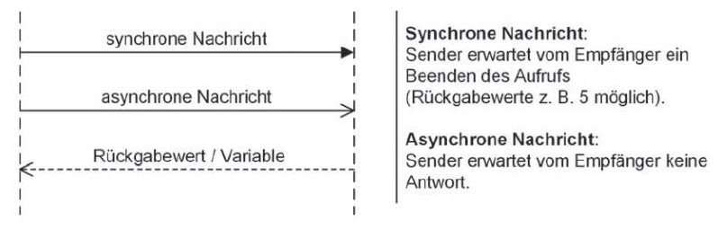
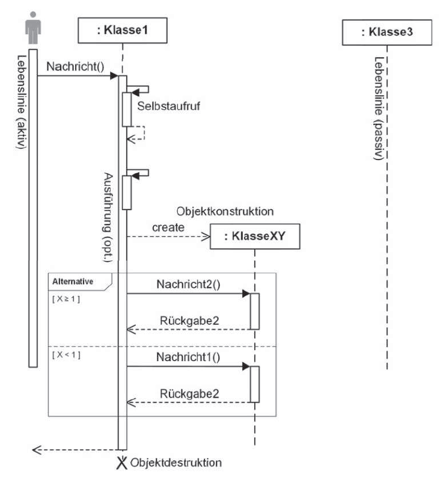
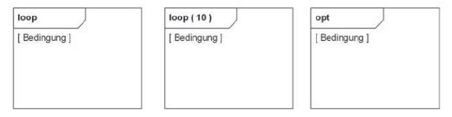
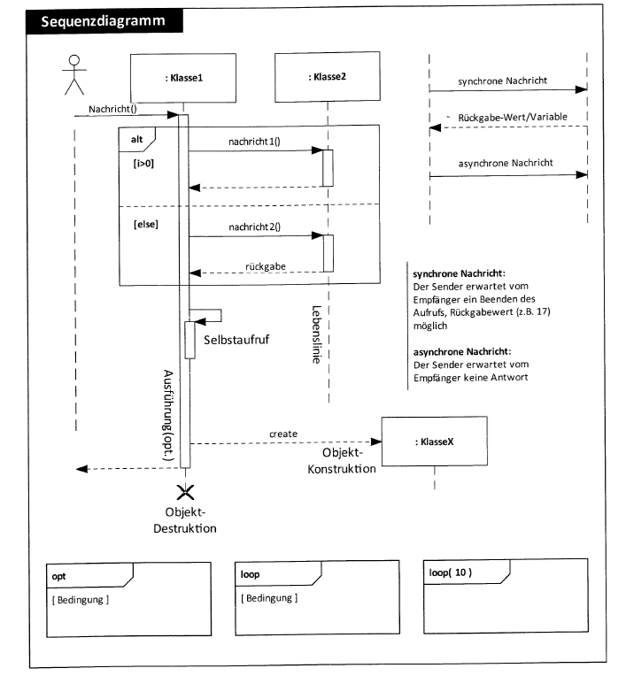
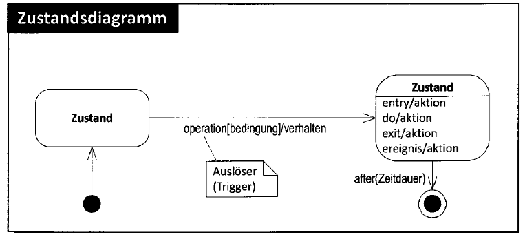

## Sequenzdiagramm: Nachrichten




## <!-- -->

:::: columns
::: {.column width="35%"}

### Sequenz-diagramm: Lebenslinien

:::

::: {.column width="65%"}



:::
::::


## Sequenzdiagramm: Bedingungen



## <!-- -->

:::: columns
::: {.column width="35%"}

### Sequenz-diagramm: Überblick

:::

::: {.column width="65%"}

{fig-align="center" width="100%"}

:::
::::


## Sequenzdiagramm: Beispiel

```{mermaid}
sequenceDiagram
    actor Benutzer
    participant LoginController
    participant Datenbank
    participant Session

    Benutzer->>LoginController: login(user,pw)
    LoginController->>Datenbank: prüfeUser(user,pw)
    Datenbank-->>LoginController: Ergebnis

    alt gültig
        LoginController->>Session: erzeugeSession()
        Session-->>LoginController: SessionID
        LoginController-->>Benutzer: Erfolg
    else ungültig
        LoginController-->>Benutzer: Fehler
    end
```


## Sequenzdiagramm: Mermaid {.smaller}

```
sequenceDiagram
    actor Benutzer
    participant LoginController
    participant Datenbank
    participant Session

    Benutzer->>LoginController: login(user,pw)
    LoginController->>Datenbank: prüfeUser(user,pw)
    Datenbank-->>LoginController: Ergebnis

    alt gültig
        LoginController->>Session: erzeugeSession()
        Session-->>LoginController: SessionID
        LoginController-->>Benutzer: Erfolg
    else ungültig
        LoginController-->>Benutzer: Fehler
    end
```


## Sequenzdiagramm: Zusammenfassung

:::: {style="font-size: 1.9rem"}

**Was stellt ein Sequenzdiagramm in UML dar und in welchen Szenarien wird es typischerweise verwendet?**

::: incremental

- Ein **Sequenzdiagramm** in UML zeigt die **Interaktionen zwischen Objekten** in der **Reihenfolge**, in der sie auftreten
- Es besteht aus 
  + einer Reihe von vertikalen **"Lebenslinien"**, die Objekte oder Klassen repräsentieren, und
  + horizontalen **"Nachrichten"**, die zwischen den Lebenslinien hin und her gehen
- Nachrichten sind zeitlich von oben nach unten geordnet, sodass man sehen kann, in welcher Reihenfolge die Interaktionen auftreten
- Sequenzdiagramme helfen dabei, die **dynamischen Interaktionen** in einem System darzustellen und zu analysieren

:::
::::

::: notes
Lernkarte AP2 2025 Nr. 128
:::


## Zustandsdiagramm




## Zustandsdiagramm: Bestellung

:::: {style="font-size: 1.5rem"}

```{.text style="overflow: hidden;"}
   (●)
    |
    v
+----------+   bestellen()    +-----------+
|  Neu     |----------------->| Bestaetigt|
+----------+                  +-----------+
                                   |
                    zahlung_ok()   |
                                   v
                             +----------+
            stornieren()     | Bezahlt  |
  +----------<---------------|          |
  |                          +----------+
  v                                |
+----------+          versenden()  |
|Storniert |                       v
+----------+              +-----------+
  |                       | Versendet |
  v                       +-----------+
 (◉)                           |
                  zugestellt() |
                               v
                        +-----------+
                        | Geliefert |
                        +-----------+
                               |
                               v
                              (◉)
```

::::


## Zustandsdiagramm: Bestellung

```{mermaid}
stateDiagram-v2

    direction LR

    [*] --> Neu
    Neu --> Bestaetigt : bestellen()

    Bestaetigt --> Bezahlt : zahlung_ok()
    Bestaetigt --> Storniert : stornieren()

    Bezahlt --> Versendet : versenden()
    Versendet --> Geliefert : zugestellt()

    Geliefert --> [*]
    Storniert --> [*]
```


#### Mermaid-Code

::: {.fragment style="font-size: 1.8rem"}

```
stateDiagram-v2

    direction LR

    [*] --> Neu
    Neu --> Bestaetigt : bestellen()

    Bestaetigt --> Bezahlt : zahlung_ok()
    Bestaetigt --> Storniert : stornieren()

    Bezahlt --> Versendet : versenden()
    Versendet --> Geliefert : zugestellt()

    Geliefert --> [*]
    Storniert --> [*]
```

:::


## Zustandsdiagramm: Zusammenfassung

:::: {style="font-size: 1.9rem"}

**Erklären Sie die Verwendung des UML-Zustandsdiagramms zur Modellierung von Verhalten in einem System.**

::: incremental

- **UML-Zustandsdiagramm** bildet **Lebenszyklus** eines Objekts ab durch Darstellung seiner verschiedenen **Zustände und Übergänge**
- Besonders nützlich bei der Modellierung von **Objekten, die komplexes Verhalten aufweisen** und viele verschiedene Zustände haben können
- Was geben Zustandsdiagramme wieder?
  + den aktuellen **Zustand** eines Objekts
  + die **Aktionen**, die beim **Eintritt**, während des **Verweilen**s und beim **Verlassen des Zustands** durchgeführt werden
  + **Bedingungen für den Übergang** zu anderen Zuständen
- Ermöglichen die Darstellung und das Verständnis komplexer **verhaltensbasierter Systeme**

:::
::::

::: notes
Lernkarte AP2 2025 Nr. 130
:::


## <!-- -->

{fig-align="center" width="50%"}

::: {style="text-align: center; font-size: 1rem;"}
[©torange.biz](https://torange.biz/cup-coffee-30851) CC-BY 4.0
:::

::: {style="color: green; text-align: center; font-size: 2.8rem"}
**Viel Erfolg!**
:::
