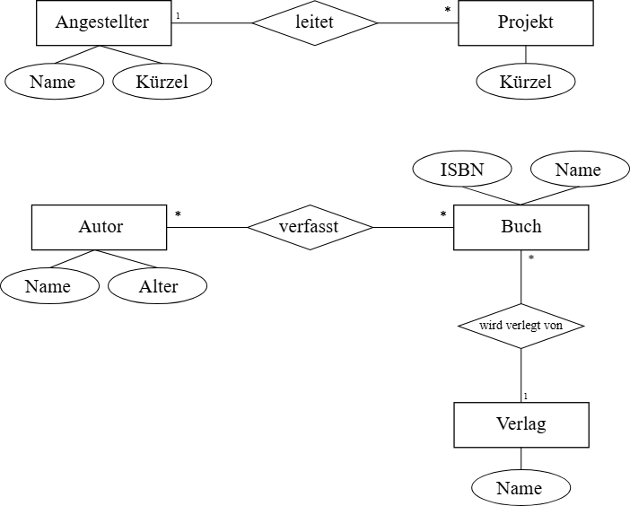

## Relationale vs. Nicht-relationale DBs

::::: {style="font-size: 1.8rem"}

**Was sind relationale Datenbanken? - Nennen Sie zwei Beispiele für nicht-relationale Datenbanktypen.**

:::: columns
::: {.column .incremental}

### Relationale Datenbanken

- Datenbanken, die auf dem **relationalen Datenbankmodell** basieren
- Speichern Daten in Tabellen, die aus Zeilen und Spalten bestehen
- Beziehungen zwischen Tabellen werden durch **Primärschlüssel-Fremdschlüssel-Beziehungen** hergestellt

:::

::: {.column .incremental}

### Nicht-relationale Datenbanktypen: Beispiele

- Dokumentenorientierte Datenbanken
- Schlüssel-Wert-Datenbanken
- Spaltenorientierte Datenbanken
- Graphdatenbanken
- Zeitreihendatenbanken
- Objektorientierte Datenbanken

:::
::::
:::::

::: notes
Lernkarte AP2 2025 Nr. 98
:::


## Relationale vs. NoSQL-Datenbanken

::: {style="font-size: 1.8rem"}

| Merkmal | Relational (SQL) | NoSQL |
|:---|:------|:------|
| Struktur | Tabellen mit Spalten | Dokumente, Key-Value, Graphen |
| Schema | Festes Schema | Flexibles / kein Schema |
| Sprache | SQL | Abhängig vom System |
| Konsistenz | ACID (stark) | BASE (eventual consistency) |
| Skalierung | Vertikal (größerer Server) | Horizontal (mehr Server) |
| Beispiele | MySQL, PostgreSQL, MariaDB | MongoDB, Redis, Cassandra, Neo4j |
| Einsatz | Strukturierte Daten, Transaktionen | Big Data, flexible Strukturen |

:::


## ODBC

:::: {.incremental style="font-size: 2.1rem"}

**Wofür steht die Abkürzung ODBC?**

- **ODBC** = ***Open Database Connectivity***
- Standardisierte Schnittstelle für den Zugriff auf verschiedene Datenbankmanagementsysteme (DBMS)
- Sie ermöglicht Anwendungen, SQL-Abfragen unabhängig vom verwendeten Datenbanktyp auszuführen

::::

::: notes
Lernkarte AP2 2025 Nr. 117
:::


## Primärschlüssel vs. Fremdschlüssel

::::: {style="font-size: 1.9rem"}

**Erklären Sie in Bezug auf Datenbanken die Begriffe *Primärschlüssel* und *Fremdschlüssel*.**

:::: columns
::: {.column .incremental}

### Primärschlüssel

- **Feld** oder **Kombination von Feldern** in einer Tabelle, das / die **jede Zeile eindeutig identifiziert**
- Jeder Primärschlüssel ist **eindeutig** innerhalb der Tabelle und es darf keine Duplikate oder Nullwerte geben

:::

::: {.column .incremental}

### Fremdschlüssel

- **Feld** oder **Kombination von Feldern** in einer Tabelle, das **auf** den **Primärschlüssel** einer anderen Tabelle **verweist**
- Zweck: **Integrität** der Daten zu gewährleisten und **Beziehungen** zwischen Tabellen herzustellen

:::
::::
:::::

::: notes
Lernkarte AP2 2025 Nr. 103
:::


---

### Entity-Relationship-Modell (ER): Beispiele



Siehe [J. Loetzsch, LF7 Github](https://github.com/johannesloetzsch/LF7/blob/main/src/pruefung/uml.md#entity-relationship-modell-erm)


---

### Entity-Relationship-Modell (ER): Bestandteile

:::: {style="font-size: 2rem"}

| Element | Symbol | Beschreibung |
|---|---|---|
| Entität | Rechteck | Objekt / Datensatz (z.B. Kunde, Produkt) |
| Attribut | Oval | Eigenschaft einer Entität (z.B. Name) |
| Beziehung | Raute | Verbindung zwischen Entitäten |
| Primärschlüssel | Unterstrichenes Attribut | Eindeutige Identifikation |

::::


## ER-Modell: Kardinalitäten

:::: {.fragment style="font-size: 2rem"}

<br>

| Notation | Bedeutung | Beispiel |
|---|---|---|
| 1:1 | Genau eine Zuordnung | Person → Personalausweis |
| 1:n | Eine Entität → mehrere | Abteilung → Mitarbeiter |
| n:m | Mehrere → mehrere | Student → Vorlesung |

<br>

**n:m-Auflösung:** [Zwischentabelle mit Fremdschlüsseln beider Seiten]{.fragment}

::::


## ER-Diagramm: Schritte

:::: {.incremental style="font-size: 1.9rem"}

**Welche Schritte sind notwendig, um Datenstrukturen in einem ER-Diagramm zu modellieren?**

1. **Identifizieren der Entitäten:** Das sind die Hauptobjekte oder Konzepte in der Datenbank.
2. **Bestimmen der Attribute:** Das sind die Eigenschaften oder Merkmale der Entitäten.
3. **Identifizieren der Beziehungen:** Das sind die Verbindungen und Interaktionen zwischen den Entitäten.
4. **Bestimmen der Kardinalität:** Das definiert, wie viele Instanzen einer Entität mit einer Instanz einer anderen Entität in Beziehung stehen können.

::::

::: notes
Lernkarte AP2 2025 Nr. 107
:::


## Datenbanken: Datentypen

:::: {.fragment style="font-size: 1.7rem"}

| Datentyp | Beschreibung | Beispiel |
|:---|:-----|:-----|
| INT / INTEGER | Ganzzahl | Alter, Menge |
| FLOAT / DOUBLE | Gleitkommazahl | Preis (ungenau!) |
| DECIMAL(p,s) | Festkommazahl | Währung: `DECIMAL(10,2)` |
| VARCHAR(n) | Text variabler Länge | `Name VARCHAR(100)` |
| CHAR(n) | Text fester Länge | `PLZ CHAR(5)` |
| TEXT | Langer Text | Beschreibung |
| DATE | Datum | Geburtsdatum |
| DATETIME / TIMESTAMP | Datum + Uhrzeit | Erstellungszeitpunkt |
| BOOLEAN | Wahrheitswert | Aktiv: `TRUE/FALSE` |
| BLOB / BINARY | Binärdaten, Binär-String | Bilder, Dateien |

[**Richtiger Datentyp: Datenintegrität, Speichereffizienz**]{.fragment}

::::

::: notes
vgl. Lernkarte AP2 2025 Nr. 102
:::


## NULL

:::: {.incremental style="font-size: 1.9rem"}

**Was bedeutet der Begriff `NULL` in Bezug auf Datenbanken und welche Rolle spielt es bei der Datenverarbeitung und -abfrage?**

- `NULL` in DBS: Feld hat keinen Wert: **NULL ≠ 0; NULL ≠ Leerzeichen**!
- `NULL` repräsentiert **fehlende oder unbekannte Daten**
- Bei fehlenden Daten kann `NULL` eingefügt werden
- In Abfragen wird `IS NULL` oder `IS NOT NULL` verwendet, um `NULL`-Werte zu finden
- Arithmetische Operationen mit `NULL` ergeben `NULL`
- Aggregatfunktionen wie `COUNT` oder `SUM` ignorieren `NULL`-Werte
- Oft werden `NULL`-Werte in Datenbankindizes nicht berücksichtigt

::::

::: notes
Lernkarte AP2 2025 Nr. 115
:::


## Spalten-Indizierung

:::: {.incremental style="font-size: 1.8rem"}

**Warum ist die Indizierung von Spalten in einer Datenbank wichtig und wie kann sie die Leistung von Abfragen verbessern?**

- Index bietet schnellen Zugriff auf Daten
- Enthält eine sortierte Liste von Werten einer bestimmten Spalte und Verweise auf Speicherorte der zugehörigen Daten
- Wenn Abfrage indizierte Spalte verwendet -> DB-System kann Index verwenden, um **schnell** zu den benötigten Daten zu navigieren, **anstatt alle Zeilen durchsuchen** zu müssen
- Kann Leistung von Abfragen erheblich verbessern
- Nachteil: gewisser **Overhead**: **Speicherplatz** sowie **Verarbeitungszeit bei Schreibvorgängen**, da Index immer aktualisiert werden muss

::::

::: notes
Lernkarte AP2 2025 Nr. 111
:::


## DBs: Anomalien und Redundanzen

:::: {.fragment style="font-size: 1.7rem"}

**Def.: Datenbankanomalien sind Probleme, die in einer Datenbank auftreten und zu Inkonsistenzen oder unerwünschten Effekten führen können.**

::: fragment

| Anomalie | Beschreibung | Beispiel |
|:---|:-----|:----|
| Einfüge-Anomalie | Daten können nicht ohne Zusatzinfo eingefügt werden | Neuer Kunde ohne Auftrag |
| Änderungs-Anomalie | Änderung an mehreren Stellen nötig | Kundenadresse in jeder Bestellung |
| Lösch-Anomalie | Beim Löschen gehen andere Daten verloren | Letzter Auftrag gelöscht → Kundendaten weg |

:::

**Lösung:**

::: incremental

- Normalisierung → Redundanzen eliminieren:
  + Aufteilung von Tabellen
  + klare Definition von Beziehungen zwischen Tabellen

:::
::::

::: notes
vgl. Lernkarte AP2 2025 Nr. 105
:::


## Normalisierung: Warum?

**Normalisierung ist ein systematisches Verfahren zur Strukturierung relationaler Datenbanken, um Redundanzen zu vermeiden und Anomalien (Einfüge-, Änderungs- und Löschanomalien) zu verhindern.**


## Normalisierung: 1. Normalform (1NF)

::: fragment

- Jedes Attribut enthält nur **atomare** (unteilbare) Werte
- Keine Wiederholungsgruppen

**Verstoß:** [Telefon = "0123, 0456" → Aufteilen in separate Datensätze / Tabelle]{.fragment}

:::

::: notes
vgl. Lernkarte AP2 2025 Nr. 106 für alle drei NF
:::


## Normalisierung: 2. Normalform (2NF)

::: fragment

- 1NF erfüllt
- Jedes Nicht-Schlüssel-Attribut ist **voll funktional abhängig** vom gesamten Primärschlüssel
- Relevant bei zusammengesetzten Schlüsseln

:::


## Normalisierung: Funktionale Abhängigkeit

:::: {style = "font-size: 2.1rem"}

**Definition:** [Ein Attribut B ist funktional abhängig von Attribut A, wenn zu jedem Wert von A genau ein Wert von B gehört.]{.fragment}

**Schreibweise:** [A → B (A bestimmt B)]{.fragment}

::: incremental

**Beispiele:**

- KundenNr → Name (zu jeder KundenNr gehört genau ein Name)
- BestellNr → Datum (zu jeder BestellNr gehört genau ein Datum)
- PLZ → Ort (zu jeder PLZ gehört genau ein Ort) - vereinfacht

:::
::::


## Normalisierung: 3. Normalform (3NF)

::: fragment

- 2NF erfüllt
- Keine **transitiven Abhängigkeiten** <br> Nicht-Schlüssel-Attribut hängt nicht von anderem Nicht-Schlüssel-Attribut ab

**Beispiel transitive Abhängigkeit:**

:::

::: {.fragment style="font-size: 2rem"}

Mitarbeiter → AbteilungsNr → AbteilungsName  (transitiv!)  
Lösung: [AbteilungsName in eigene Tabelle "Abteilung"]{.fragment}

:::


## Normalisierung: Transitive Abhängigkeit

:::: {style = "font-size: 2.1rem"}

**Definition:** [B ist transitiv abhängig von A, wenn A → C und C → B gilt, wobei C kein Schlüsselattribut ist.]{.fragment}

**Schreibweise:** [A → C → B]{.fragment}

::: incremental

**Beispiel:** [KundenNr → PLZ → Ort]{.fragment}

- KundenNr bestimmt PLZ
- PLZ bestimmt Ort
- Also: Ort ist transitiv abhängig von KundenNr (über PLZ)

:::
::::


## Normalisierung: Beispiel

:::: {style="font-size: 2rem"}

### Ausgangspunkt

::: {style="font-size: 1.6rem"}

| BestellNr | Datum | KundenName | KundenOrt | Artikel | Preis |
|---|---|---|---|---|---|
| 1001 | 2024-01-15 | Müller GmbH | Berlin | Server, Switch | 5000, 500 |
| 1002 | 2024-01-20 | Müller GmbH | Berlin | Kabel | 50 |

:::

<br>

### Probleme

::: incremental

- Mehrere Werte in einer Zelle (Artikel, Preis)
- Redundanz (KundenName / Ort)

:::
::::


## Beispiel: 1NF

<br>

::: {style="font-size: 2rem"}

**Forderung:** [Jedes Attribut enthält nur **atomare** (unteilbare) Werte]{.fragment}

:::

<br>

::: {.fragment style="font-size: 1.7rem"}

| BestellNr | Datum | KundenName | KundenOrt | Artikel | Preis |
|---|---|---|---|---|---|
| 1001 | 2024-01-15 | Müller GmbH | Berlin | Server | 5000 |
| 1001 | 2024-01-15 | Müller GmbH | Berlin | Switch | 500 |
| 1002 | 2024-01-20 | Müller GmbH | Berlin | Kabel | 50 |

:::


## Beispiel: 2NF

::: {style="font-size: 1.7rem"}

| BestellNr | Datum | KundenName | KundenOrt | Artikel | Preis |
|---|---|---|---|---|---|
| 1001 | 2024-01-15 | Müller GmbH | Berlin | Server | 5000 |
| 1001 | 2024-01-15 | Müller GmbH | Berlin | Switch | 500 |
| 1002 | 2024-01-20 | Müller GmbH | Berlin | Kabel | 50 |

:::

:::: {style="font-size: 1.8rem"}

**Forderung:** [Jedes Nicht-Schlüssel-Attribut ist **voll funktional abhängig** vom gesamten Primärschlüssel]{.fragment}

- Was ist der Primärschlüssel? [{BestellNr, Artikel}]{.fragment}
- Wo ist 2NF verletzt? [KundenName / KundenOrt hängen nur von BestellNr ab]{.fragment}
- Lösung? [Abhängige Attribute in separate Tabelle auslagern]{.fragment}
  + [**Bestellung:** BestellNr, Datum, KundenName, KundenOrt]{.fragment}
  + [**BestellPosition:** BestellNr, Artikel, Preis]{.fragment}

::::


## Beispiel: 3NF

:::: {.columns style="font-size: 1.6rem"}
::: {.column width="60%"}

| BestellNr | Datum | KundenName | KOrt
|---|---|---|---|
| 1001 | 2024-01-15 | Müller GmbH | Berlin

:::

::: {.column width="40%"}

| BestellNr | Artikel | Preis
|---|---|---
1001 | Server | 5000
1001 | Switch | 500

:::
::::

:::: {style="font-size: 1.8rem"}

**Forderung:** [Keine transitiven Abhängigkeiten]{.fragment}

::: incremental

- Wo ist 3NF verletzt? [KundenOrt hängt von KundenName ab (transitiv)]{.fragment}
- Lösung? [Auslagerung in separate Tabelle]{.fragment}
  + [**Kunde:** KundenID, KundenName, KundenOrt]{.fragment}
  + [**Bestellung:** BestellNr, Datum, KundenID (FK)]{.fragment}
  + [**BestellPosition:** BestellNr (FK), Artikel, Preis]{.fragment}

:::
::::


## Datenbanken: ACID

:::: {style="font-size: 1.8rem"}

::: incremental

- **A**: *Atomicity* = **Atomität**: Transaktion wird entweder vollständig oder gar nicht ausgeführt; falls Fehler: Rollback
- **C**: *Consistency* = **Konsistenz**: Datenbank führt nur Transaktionen aus, die alle vordefinierten Regeln, Gesetze und Integritätsbedingungen einhalten
- **I**: *Isolation* = **Isolation**: Gleichzeitig laufende Transaktionen behindern sich nicht gegenseitig; sie wirken so, als würden sie nacheinander ablaufen
- **D**: *Durability* = **Dauerhaftigkeit**: Sobald eine Transaktion erfolgreich abgeschlossen *(committed)* ist, bleiben die Änderungen **dauerhaft** gespeichert - selbst bei einem Stromausfall oder Systemabsturz
- Beispiel: Bei einer Überweisung werden beide Buchungen <br> (A: -100€; B: +100€) als eine Transaktion betrachtet.

:::

Vertreter: [PostgreSQL, Oracle, SQL Server, MySQL / InnoDB]{.fragment}

::::


## Datenbanken: BASE

:::: {style="font-size: 1.9rem"}

::: incremental

- **BASE**: *Basically available, soft state, and eventually consistent* <br> = grundsätzlich verfügbar, weicher Zustand, und schließlich konsistent
- Benutzer können jederzeit gleichzeitig zugreifen; ein Benutzer muss nicht warten, bis andere ihre Transaktionen abgeschlossen haben
- *soft state*: Daten können vorübergehend temporäre Zustände haben, die sich auch ohne externe Trigger / Eingaben ändern können  
  Beispiel: Beitrag in sozialen Netzwerken wird von mehreren Benutzern gleichzeitig bearbeitet; Änderung nicht sofort für alle sichtbar; später wird Beitrag automatisch aktualisiert
- *eventually consistent*: Datensatz erreicht Konsistenz, wenn alle gleichzeitigen Aktualisierungen abgeschlossen sind

:::

Vertreter: [Cassandra, Riak, DynamoDB]{.fragment}

::::


## Datenbanken: ACID vs. BASE

:::: {style="font-size: 1.9rem"}

::: fragment

ACID | BASE
-----|-----
sofortige Konsistenz | spätere Konsistenz
starke Transaktionen | schwache Transaktionen
eher vertikale Skalierung | starke horizontale Skalierung
typische SQL-Systeme | typische NoSQL-Systeme
Korrektheit priorisiert | Verfügbarkeit priorisiert

:::

::: fragment

- Moderne Datenbanken sind häufig Mischformen!
- Verteilte Cloud-Datenbanken (z. B. von Amazon, Azure, Google Cloud) bieten oft konfigurierbare Konsistenzstufen
- Somit entscheidet der Anwender, wie weit er sich in Richtung ACID oder BASE bewegen möchte

:::
::::


## CAP-Theorem vs. ACID und BASE

::::: {style="font-size: 2rem"}

CAP-Theorem: **C**onsistency, **A**vailability, **P**artition Tolerance

Bei Netzwerkausfällen kann man **nicht alle drei gleichzeitig garantieren**.

:::: columns
::: column

### BASE

::: incremental

- priorisiert *Availability* und *Partition Tolerance*
- Datenbank bleibt hochverfügbar und verteilt
- bessere **Skalierbarkeit**
- Konsistenz wird notfalls erst später erreicht; *eventual consistency*

:::
:::

::: column

### ACID

::: incremental

- priorisiert *Consistency*: Datenbank nach jeder Transaktion sofort konsistent

:::
:::
::::
:::::


## Referenzielle Integrität

:::: {.incremental style="font-size: 2rem"}

**Was ist referenzielle Integrität in Bezug auf Datenbanken?**

- **Referenzielle Integrität** bezieht sich auf die **Konsistenz von Beziehungen** zwischen Tabellen
- Sie soll sicherstellen, dass in einer Beziehung zwischen zwei Tabellen **der Wert des Fremdschlüssels in der referenzierten Tabelle immer auf einen gültigen Wert verweist**
- Wenn eine Änderung oder Löschung in einer Tabelle vorgenommen wird:
  + referenzielle Integrität prüft, ob dies Auswirkungen auf andere Tabellen hat und
  + ob die Konsistenz der Beziehungen erhalten bleibt

::::

::: notes
Lernkarte AP2 2025 Nr. 104
:::


## SQL Sprachbereiche

:::: {.fragment style="font-size: 1.8rem"}

Bereich | Bedeutung | Typische Befehle
:-------------|:--------|:--------
**DDL** - *Data Definition Language* | Datenstrukturen definieren, ändern | CREATE, ALTER, DROP
**DML** - *Data Manipulation Language* | Daten einfügen, ändern, löschen | INSERT, UPDATE, DELETE
**DQL** - *Data Query Language* | Daten abfragen | SELECT
**DCL** - *Data Control Language* | Rechte, Zugriffe verwalten | GRANT, REVOKE
**TCL** - *Transaction Control Language* | Transaktionen steuern | COMMIT, ROLLBACK, SAVEPOINT

::::

::: notes
Welche Lernkarte? Lernkarten ergänzen (ROLLBACK; mehrere?)
:::


## DDL - Data Definition Language

<br>

```sql
CREATE TABLE Kunde (
    KundenID INT PRIMARY KEY AUTO_INCREMENT,
    Name VARCHAR(100) NOT NULL,
    Email VARCHAR(150) UNIQUE,
    Erstellt DATE DEFAULT CURRENT_DATE
);

ALTER TABLE Kunde ADD Telefon VARCHAR(20);

CREATE INDEX idx_name ON Kunde(Name);
```

## DML - Data Manipulation Language

<br>

```sql
INSERT INTO Kunde (Name, Email) VALUES ('Mueller GmbH', 'info@mueller.de');

UPDATE Kunde SET Email = 'neu@mueller.de' WHERE KundenID = 1;

DELETE FROM Kunde WHERE KundenID = 5;
```

## DQL - Data Query Language

<br>

```sql
-- Projektion + Selektion
SELECT Name, Email FROM Kunde WHERE KundenID > 10;

-- Sortieren
SELECT * FROM Kunde ORDER BY Name ASC;

-- Aggregatfunktionen + Gruppieren
SELECT AbteilungsID, COUNT(*) AS Anzahl, AVG(Gehalt) AS Durchschnitt
FROM Mitarbeiter
GROUP BY AbteilungsID
HAVING COUNT(*) > 5;
```


## DCL - Data Control Language

<br>

:::: columns
::: column

```sql
GRANT SELECT, INSERT, UPDATE
ON kunden
TO max;
```

[Max darf Tabelle `kunden` lesen, dort Daten einfügen und aktualisieren.]{style="font-size: 2rem"}

:::

::: column

```sql
REVOKE UPDATE
ON kunden
FROM max;
```

[Max darf Tabelle `kunden` weiter lesen und Datensätze anlegen, aber keine bestehenden Datensätze mehr ändern.]{style="font-size: 2rem"}

:::
::::


## SQL: Transaktion

:::: {.incremental style="font-size: 1.8rem"}

**Was versteht man unter dem Begriff *Transaktion* im Kontext von SQL-Statements?**

- Transaktion in SQL: **Gruppe von miteinander verbundenen Anweisungen, die als eine einzelne Arbeitseinheit behandelt werden**
- Sie folgen dem **ACID-Prinzip:**
  + **Atomarität (Atomicity):** Alles oder nichts. Alle Operationen der Transaktion werden erfolgreich ausgeführt oder gar keine.
  + **Konsistenz (Consistency):** Die Transaktion bringt die Datenbank von einem konsistenten Zustand in einen anderen.
  + **Isolation:** Jede Transaktion wird so behandelt, als ob sie isoliert von anderen läuft.
  + **Dauerhaftigkeit (Durability):** Nachdem eine Transaktion abgeschlossen ist, sind ihre Auswirkungen dauerhaft.

::::

::: notes
Lernkarten AP2 2025 Nr. 112
:::


## TCL - Transaction Control Language

:::: {.incremental style="font-size: 2rem"}

**Erklären Sie die Funktion und Verwendung der folgenden SQL-Befehle im Zusammenhang mit Transaktionen: `BEGIN TRANSACTION; COMMIT; ROLLBACK;`**

- `BEGIN TRANSACTION`: Dieser Befehl signalisiert den Beginn einer Transaktion.
- `COMMIT`: Schließt die Transaktion ab und speichert alle Änderungen **dauerhaft** in der Datenbank. Nach einem `COMMIT` kann die Transaktion nicht mehr rückgängig gemacht werden.
- `ROLLBACK`: Macht alle Änderungen, die in der **aktuellen Transaktion** gemacht wurden, rückgängig, wenn eine Fehler auftritt oder wenn die Transaktion aus irgendeinem Grund nicht abgeschlossen werden kann.

::::

::: notes
Lernkarte AP2 2025 Nr. 113
:::


## JOINs (Abfrage über mehrere Tabellen)

::: {style="font-size: 2rem"}

| JOIN-Typ | Beschreibung |
|:---|:------|
| INNER JOIN | Nur übereinstimmende Datensätze |
| LEFT JOIN | Alle links + übereinstimmende rechts |
| RIGHT JOIN | Alle rechts + übereinstimmende links |
| FULL JOIN | Alle Zeilen mit Übereinstimmung in min. **einer** der Tabellen
| CROSS JOIN | Kartesisches Produkt (jeder mit jedem) |

:::

::: notes
ähnlich Lernkarte AP2 2025 Nr. 114
:::


## INNER JOIN

<br>

```sql
SELECT k.Name, b.Datum, b.Betrag
FROM Kunde k
INNER JOIN Bestellung b ON k.KundenID = b.KundenID
WHERE b.Betrag > 1000
ORDER BY b.Datum DESC;
```


## DB Design

:::: {style="font-size: 1.6rem"}

```text
Anforderungsanalyse
        |
        v
+----------------+     +------------------+
| ER-Modell      |---->| Relationales     |
| (konzeptionell)|     | Modell (logisch) |
+----------------+     +------------------+
                              |
            +---------+-------+
            |                 |
  +----------------+      +--------------+
  | Normalisierung |      | SQL (DDL)    |
  | 1NF-3NF        |      | CREATE TABLE |
  +----------------+      +--------------+
             |                |
             v                v
      Redundanzfreies     Physische
      Datenmodell         Datenbank
                              |
                          +---+----------+
                          |              |
                     +---------+     +-----------+
                     | DML     |     | DQL       |
                     | INSERT  |     | SELECT    |
                     | UPDATE  |     | JOIN      |
                     | DELETE  |     | GROUP BY  |
                     +---------+     +-----------+
```

::::


## DB: Stored Procedure

:::: {.incremental style="font-size: 1.7rem"}

**Was ist eine Stored Procedure und welche Vorteile bietet sie in der Datenbankentwicklung?**

- **Stored Procedure** = vorbereitete SQL-Anweisung, die auf der DB gespeichert ist
- Kann **parametrisiert** werden und mehrere SQL-Anweisungen enthalten, die komplexe Operationen ausführen

**Vorteile:**

- **Leistung:** effizienter bei wiederholten und komplexen Anfragen, da sie einmal kompiliert und direkt auf dem Server ausgeführt werden
- **Wiederverwendbarkeit:** Sie können in verschiedenen Anwendungen wiederverwendet werden
- **Sicherheit:** Sie begrenzen den direkten Zugriff auf die Datenbank
- **Transaktionskontrolle:** Sie erlauben es, mehrere Operationen als eine einzige Transaktion zu behandeln

::::

::: notes
Lernkarte AP2 2025 Nr. 109
:::


## DB: Trigger

:::: {.incremental style="font-size: 2rem"}

**Wie funktionieren Trigger in Datenbank-Umgebungen und wie können sie zur automatischen Ausführung von Aktionen verwendet werden?**

- Trigger = Art von *Stored Procedure*, die automatisch in **Reaktion auf** bestimmte **Ereignisse** in einer spezifischen Tabelle oder Ansicht in der Datenbank ausgeführt wird
- Ereignisse können **Einfügen, Aktualisieren oder Löschen** von Daten sein
- Ein Trigger wird immer **mit einer Tabelle verknüpft**
- Trigger aktiviert sich, wenn eine angegebene Datenmanipulations-Operation (DML) ausgeführt wird

::::

::: notes
Lernkarte AP2 2025 Nr. 110
:::


## <!-- -->

{fig-align="center" width="50%"}

::: {style="text-align: center; font-size: 1rem;"}
[©torange.biz](https://torange.biz/cup-coffee-30851) CC-BY 4.0
:::

::: {style="color: green; text-align: center; font-size: 2.8rem"}
**Viel Erfolg!**
:::
